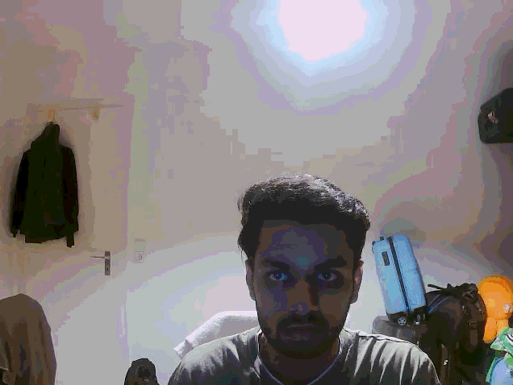

# Hand Tracking for LEAP-Hand Teleoperation

Real-time hand tracking from a webcam that converts the pose of a human hand into the
**16 joint angles** of the LEAP hand (a 16-DoF robotic hand).

This is the **perception front end** of a larger, ongoing project: teleoperating an
anthropomorphic robotic hand in NVIDIA Isaac Sim through a ROS 2 / Docker setup, driven
by camera input. This repository contains the part that is working today: the vision and
kinematics code.



## What it does

1. Reads frames from a webcam with OpenCV and mirrors them for a natural feel.
2. Detects hand landmarks with [MediaPipe Hands](https://developers.google.com/mediapipe)
   (21 landmarks per hand).
3. Picks the selected hand (left by default) and ignores the other one.
4. Computes 16 angles in radians: for the index, middle and ring fingers an abduction
   (side-to-side spread) angle plus the MCP, PIP and DIP bend angles; for the thumb an
   abduction angle, a base angle, and the PIP and DIP bend angles.
5. Draws the skeleton and a live display of all angles on the video.

`kinematics.get_leap_state()` returns the angles as a dictionary, ready to be passed to
a simulator or a ROS 2 node:

```python
{
    "index":  {"abd": ..., "mcp": ..., "pip": ..., "dip": ...},
    "middle": {"abd": ..., "mcp": ..., "pip": ..., "dip": ...},
    "ring":   {"abd": ..., "mcp": ..., "pip": ..., "dip": ...},
    "thumb":  {"abd": ..., "base": ..., "pip": ..., "dip": ...},
}
```

### How the angles are computed

- **Bend angles** are the angle at a joint between the two bones that meet there
  (for example PIP of the index finger is the angle at landmark 6 between landmarks
  5 and 7). A straight finger gives about pi, a right angle gives pi/2.
- **Spread angles** are the angle between a finger's direction vector and an anchor
  vector (the middle finger for the index, ring and thumb-to-index comparison, and the
  wrist-to-knuckle line for the middle finger).
- Angles come from `arccos` of the normalized dot product, so they are unsigned.

## Setup

Requirements: a webcam and **Python 3.10 or 3.11**. MediaPipe 0.10.14 has no installable
release for much newer Python versions, and this code uses MediaPipe's legacy
`mp.solutions.hands` API, which was removed in newer MediaPipe releases (0.10.31 and
later). So install the pinned version in a virtual environment created with an older
Python, for example `py -3.11 -m venv venv` on Windows.

```bash
python -m venv venv
# Windows:  venv\Scripts\activate
# Linux/macOS:  source venv/bin/activate
pip install -r requirements.txt
```

## Run

```bash
python tracking.py                  # left hand, camera 0
python tracking.py --hand Right     # track the right hand
python tracking.py --camera 1       # use another camera
```

Press **ESC** in the video window to exit. If the camera cannot be opened, the program
prints an error and exits; try another `--camera` index.

## Tests

The angle maths has unit tests that need neither a camera nor MediaPipe:

```bash
pip install pytest
pytest
```


